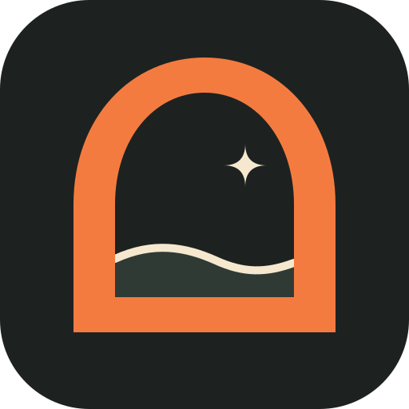

# Farcaster

A native, keyboard-first workspace for running and coordinating coding agents across harnesses, built around embedded Neovim and a terminal.

[Releases](https://github.com/behzade/farcaster/releases) · [Harness support](docs/harnesses.md) · [Shortcuts](docs/shortcuts.md) · [License](LICENSE)


The agent space moves fast, and switching harnesses shouldn't mean relearning the interface or leaving Neovim behind. Farcaster puts your existing harnesses and subscriptions into one keyboard-driven workspace (with support for other terminal and external editors too).

## Supported Harnesses

Farcaster is in daily use, though it is still early and bugs or missing features are expected.

- [Codex](https://github.com/openai/codex) (`codex-cli` app server)
- [Pi](https://github.com/badlogic/pi-mono) (Pi RPC)
- [OpenCode](https://opencode.ai/) (v2+ `opencode` server)
- [Cursor](https://cursor.com/cli) (Cursor SDK)
- [Claude Code](https://github.com/anthropics/claude-code) (`claude -p`)
- Antigravity (`agy` ACP)

See the [harness feature table](docs/harnesses.md) for per-harness capabilities and caveats.

## Getting Started

Download the latest build from [Releases](https://github.com/behzade/farcaster/releases), and make sure your chosen harness (installed and signed in) and editor launcher are available in your environment.

- **macOS (ARM64):** The app is ad hoc signed and not notarized. If macOS blocks launch, allow it via System Settings → Privacy & Security → Open Anyway ([Apple guide](https://support.apple.com/102445)).
- **Linux (x86_64):** Available as a `.deb` package or AppImage. For the AppImage, mark it executable (`chmod +x /path/to/Farcaster.AppImage`) even when using `appimage-run` so desktop launchers can resolve its icon.
- **Nix (Linux x86_64 / aarch64):** With flakes enabled, install or run directly (builds from source without a binary cache):

  ```sh
  nix profile install github:behzade/farcaster
  # or run without installing:
  nix run github:behzade/farcaster
  ```

## Features

### Neovim (and other editors)


Each session has its own embedded Neovim and terminal tab powered by `libghostty` (`agent | editor | terminal`):

- Open the transcript as a temporary Markdown buffer in Neovim to navigate, select, and copy.
- Send prompts with line or visual-selection context from Neovim to the current session, another session, or a new task.

Not using Neovim? You can swap in another terminal editor inside Farcaster or open changed files in an external editor.

### Coordination Tools (MCP)

Farcaster includes an optional local MCP server (toggleable in Settings) shared across harnesses:

- **Workgraph:** Persistent tasks and dependencies (`workgraph_*`) that outlive any single session.
- **Worker Tools:** Spawn and message worker sessions across harnesses, providers, and models.

  

- <a name="review"></a>**Review:** Agents present files, line ranges, and notes via `submit_review`. Open them in your chosen editor, with quickfix navigation in Neovim.

### Voice

Send spoken prompts (including code context from the editor) using Hex by enabling Voice in Settings → General. See [voice shortcuts](docs/shortcuts.md#voice) for controls.

- Requires Hex desktop running with its local API (Linux: Hex 3.3+; macOS: the Rust version of Hex).
- Spoken replies (when outside chat) use `say` on macOS and `espeak-ng` on Linux (included in Nix, recommended by Debian, install separately for AppImage/Arch).

## Development

Bug reports and focused pull requests are welcome; open an issue first for larger features. See [CONTRIBUTING.md](CONTRIBUTING.md).

Build and run from a local checkout with the included Nix dev shell:

```sh
nix develop
cargo run --locked --bin farcaster
```

## Documentation

- [Keyboard shortcuts](docs/shortcuts.md)
- [Harness feature table](docs/harnesses.md)

## Thanks

Thanks to [Zed](https://zed.dev/) for [GPUI](https://gpui.rs/), [GPUI Component](https://github.com/longbridge/gpui-component), and [T3 Code](https://github.com/pingdotgg/t3code) for the UI inspiration. Licensed under [GPL-3.0-or-later](LICENSE).
